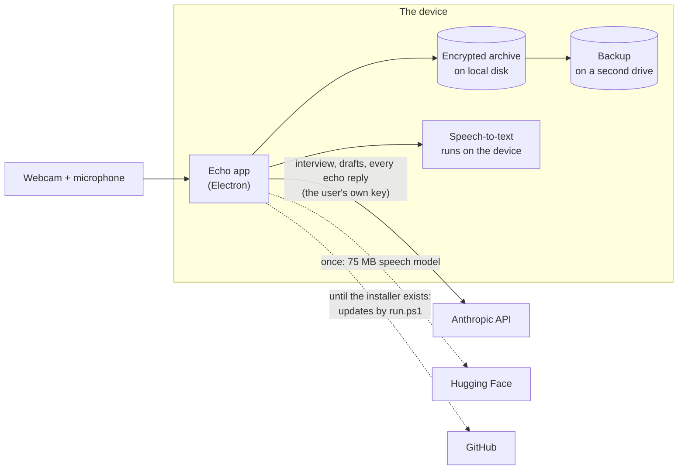

# Echo: dependencies and device spec

Written 2026-11-12, at build step 13 of 22. Versions are read from `package.json` and
`package-lock.json`. Figures marked **measured** come from the automated checks or from Marc's PC.
Figures marked **estimate** are engineering judgement and have not been measured.

## Read this first: "24/7" is not built yet

Echo today is a desktop app that someone sits at. It is not yet a service that runs unattended:

| Needed for 24/7 | Today |
|---|---|
| Starts by itself after a restart or power cut | No. It is started by hand |
| Opens the archive without a person | No. The passphrase is typed each time, by design |
| Family can reach it from their own devices | No. That is sub-project 4 (family access) |
| Keeps running with nobody logged in | No. It is a window in a logged-in Windows session |

So a device can be left on with Echo open, but one Windows update restart stops it until someone
types the passphrase. And while it is left open the archive is unlocked: Echo has no idle lock, so
anyone at the device can read everything in it. Where the echo lives 24/7 (a box at home or a cloud server) and how it unlocks
unattended are decisions for the sub-project 4 grill. They are Marc's, and they are not made.

## What talks to what

## Dependencies

### Inside the app (shipped with it)

| What | Version | What it is for |
|---|---|---|
| Electron | 45.3.0 | The app window. Carries its own Chromium and Node.js |
| React, React DOM | 19.3.1 | The screens |
| @huggingface/transformers | 4.3.2 | Speech-to-text on the device |
| onnxruntime-node (comes with the line above) | 1.30.0 | The engine that runs the speech model. Native code, CPU only |
| sharp (comes with the same) | 0.35.5 | Not used by Echo directly |
| Speech model `Xenova/whisper-base.en`, 8-bit | 75 MB | English speech to text. Downloaded once, then kept on the device |

72 packages are needed to run the app, out of 148 in the lockfile. There is no database engine: the
archive is encrypted files (decided at step 12a).

### Needed only to build it

| What | Version |
|---|---|
| TypeScript | 7.0.2 |
| Vite | 8.3.7 |
| @vitejs/plugin-react | 6.3.0 |
| Type packages for Node and React | as locked |

### Needed on the device today, and gone once the installer exists (step 22)

| What | Version | Why |
|---|---|---|
| Node.js | 22.18 or newer (Marc's PC has 24.18.0) | `run.ps1` builds the app from source |
| Git | any recent | `run.ps1` fetches each version |
| Windows PowerShell | as shipped with Windows | `run.ps1` |

### Online services

| Service | When | Without it |
|---|---|---|
| Anthropic API, on the user's own key with credit | Interview follow-ups, drafting the character sheet and style profile, every echo reply (two requests each) | No interview follow-ups, no drafts, the echo cannot talk. Capture still works |
| Hugging Face | Once, to download the speech model | Spoken words cannot be written down until it has been fetched |
| GitHub | Only for `run.ps1`, until the installer exists | No updates |

Not needed yet, and coming with later sub-projects: voice and avatar vendors (sub-project 3), and
family access with optional ICP storage (sub-project 4). Their requirements are not known until
those are designed.

### Hardware it uses

| What | When |
|---|---|
| Webcam and microphone | Capture only: consent, selfies, face video, voice, stories, spoken answers |
| A second drive | Backup. Echo refuses a backup on the same drive as the archive |
| Printer, or anything that saves a PDF | Once, for the recovery kit |

No graphics card is needed. Nothing in sub-projects 1 and 2 runs an AI model on the device except
speech-to-text, which uses the processor.

## Minimum device spec

For today's app (capture, and text chat with the echo), left switched on.

| | Minimum | Comfortable | Where the figure comes from |
|---|---|---|---|
| Operating system | Windows 10 or 11, 64-bit | Windows 11 | Electron supports Windows 10 and up, 64-bit. Echo has only been run on Windows 11 Home (Marc's PC) and GitHub's Windows test machine |
| Processor | 64-bit Intel or AMD, 4 cores | 6 cores | **Estimate.** Speech-to-text is the only heavy work: the test machine wrote down 6.9 s of speech in about 1.7 s (**measured**). Windows on Arm is untested |
| Memory | 8 GB | 16 GB | **Estimate, not measured.** Known parts: unlocking the archive needs about 134 MB for a moment (scrypt, N = 2^17, r = 8); the speech model is 75 MB on disk |
| System drive | 256 GB SSD | 512 GB SSD | App and its packages take 916 MB on Marc's PC (**measured**). The rest is the archive |
| Archive growth | | | Recordings are nearly all of it. Marc's archive is 10 MB with one recording (**measured**). The memory store is 21 MB at 50,000 passages (**measured**). The size of real stories, face video and 30 minutes of voice has not been measured |
| Backup drive | A second drive at least as big as the archive | External SSD, same size as the system drive | Required by the app |
| Network | Always-on broadband | Wired | Every echo reply goes to Anthropic. Text only, so speed matters little |
| Webcam and microphone | Only if capture happens on this device | | Not needed on a device that only hosts the echo |
| Graphics card | None | None | |

For reference, Marc's PC (**measured** 2026-11-12): Windows 11 Home, Intel Core i5-11400H (6 cores,
12 threads), 15.8 GB memory, C: 476 GB with 196 GB free, D: 930 GB with 745 GB free. That is well
above the comfortable column.

### What to set on a device that stays on

These are Windows and hardware settings, not Echo features:

- Never sleep or hibernate while plugged in.
- Restart automatically after a power cut (a firmware setting on most desktop and mini PCs).
- Schedule Windows updates for a time someone can type the passphrase afterwards.
- Keep the backup drive attached. A backup in the same house does not survive a fire or theft; the
  off-site copy arrives with sub-project 4.
- Keep the recovery kit somewhere other than next to the device.

## What is not known

- Memory use of the running app. It was not running on Marc's PC when this was written.
- The size of real recordings.
- Anything about sub-projects 3 and 4: where the echo is hosted 24/7, how it unlocks unattended, how
  family reach it, and what the voice and avatar vendors need.
- Whether it runs on Windows on Arm, macOS or Linux. The code is not Windows-only by design, but only
  Windows has been run, and `run.ps1` is Windows-only.
