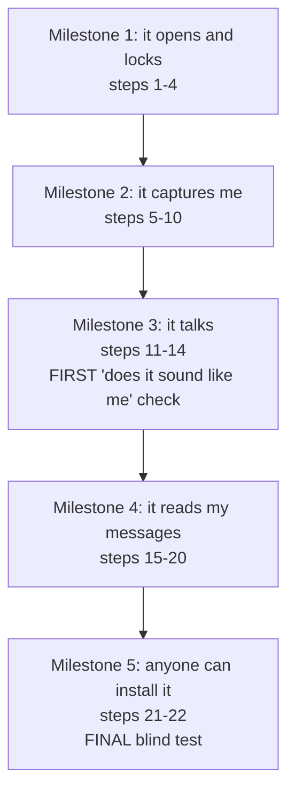

# Echo — implementation plan for sub-projects 1 and 2

**Status:** DRAFT, waiting for Marc's approval. Merging PR 2 is the approval. No code exists.
**Builds:** the design in `docs/spec-1-2-capture-and-persona.md` (approved, PR 1).

## The shape of it

Twenty-two build steps in five milestones. Each step is one PR, small enough to click through in a
few minutes. The order gets Marc talking to his echo as early as possible (milestone 3), then
widens what it knows (milestone 4).



Step numbers are not PR numbers. This plan is PR 2, so step 1 should land as PR 3, step 2 as PR 4,
and so on, unless a fix PR lands in between. Every PR title starts with its step number.

## How Marc checks each step

Step 1 delivers a script, `run.ps1`, in the repo root. From then on, checking any PR is one line in
PowerShell from the repo folder:

```powershell
.\run.ps1 7
```

That fetches PR 7, installs what it needs, and opens the app. The script checks for Node and says
what to install if it is missing. Marc then says "merge 7" or reports defects.

## Milestone 1 — it opens and locks

| Step | What lands | What Marc clicks through |
|---|---|---|
| 1 | App shell: window, home screen with every tile greyed out, `run.ps1`, automated checks on every PR | The app opens and shows the home screen |
| 2 | Setup, part 1: passphrase, archive folder, encrypted archive, lock and unlock, audit trail begins | Set a passphrase, close the app, reopen, unlock. Wrong passphrase is refused |
| 3 | Setup, part 2: recovery kit printout, and proof it was printed before going further | Print the kit, enter a code from it, then unlock using the recovery code instead of the passphrase |
| 4 | Setup, part 3: Claude API key screen with step-by-step help and a live test of the key | Paste a key, see it pass. Paste a bad key, see a plain-English reason |

## Milestone 2 — it captures me

| Step | What lands | What Marc clicks through |
|---|---|---|
| 5 | Consent gate: record the consent video with the user's name in the wording; tiles unlock after | Record consent, play it back, see tiles unlock. Withdraw consent, see the app lock down |
| 6 | People: family members, relationships, "for this person only" tagging | Add family, tag a test item for one person |
| 7 | Backup to an external drive, automatic and already encrypted | Plug in a drive, see a backup made, restore it into an empty folder |
| 8 | Life stories: record, transcribe on the PC, correct the text | Tell a two-minute story, read the transcript, fix a word |
| 9 | Face and voice masters: selfies, the guided 2-minute video, guided voice recordings with a 30-minute meter | Take selfies, record the video following the on-screen guide, record a voice passage |
| 10 | Character interview: AI interviewer with follow-ups, pause and resume | Answer three questions aloud, get follow-ups that react to what was said, resume later |

Backup is step 7 on purpose: it lands before any long recording session, so a dead laptop cannot
take real material with it.

## Milestone 3 — it talks

| Step | What lands | What Marc clicks through |
|---|---|---|
| 11 | Advice: for a named person and occasion, both kinds ("say when asked", "release on the day") | Record advice for one person and one occasion |
| 12a | The memory store: passages from his own words, readable and editable | Read the passages, correct one, leave one out |
| 12b | The character sheet and the style profile, each readable and editable | Read his own character sheet and style profile, correct something |
| 13 | Persona engine and text chat: replies as "I", opening echo line, "speaking as" selector, sources panel, memory of what each person tells it, the three kinds of statement, all checks | Chat as himself and as a family member. Ask about something never captured and get the in-character "nothing". Check the sources panel |
| 14 | Blind test: 20 questions, two judges, scoring against the agreed pass bar | Run the test with the second judge |

**First "does it sound like me" check happens at step 14**, from stories, interview and advice alone.
If it is far off, the fix is to the engine, before any time is spent on imports.

## Milestone 4 — it reads my messages

| Step | What lands | What Marc clicks through |
|---|---|---|
| 15 | Import framework and WhatsApp. Third-party words flagged and locked to the PC | Import one real WhatsApp export, see his messages and others' separated |
| 16 | Messenger, both downloads (standard export and end-to-end encrypted chats) | Import his Messenger export |
| 17 | iPhone texts and iMessage from a local iPhone backup | Make a backup, import, see threads |
| 18 | Discord data package (his messages only) | Import his Discord package |
| 19 | Email | Import a mailbox |
| 20 | Letters: photo or scan, read by the app, corrected by hand | Photograph one letter, correct the text |

Each import step ends by rebuilding the style profile, so the chat from step 13 visibly improves.
Steps 16 and 18 need the exports Marc has requested from Meta and Discord; if they have not arrived,
those steps move later and nothing else waits.

## Milestone 5 — anyone can install it

| Step | What lands | What Marc clicks through |
|---|---|---|
| 21 | Export everything in open formats; delete an item or everything | Export, open the files without Echo, delete one item and see it gone from chat |
| 22 | Windows installer, and a full pass over every screen's wording for a non-technical stranger | Install on a clean Windows account or a second PC, go from nothing to a first chat without help |

**Final blind test** after step 22, with imports in. Passing it finishes sub-projects 1 and 2 and
unlocks the spec for sub-project 3 (voice and face).

## Rules for every PR

- **No personal data in the repo, ever.** The archive lives outside the repo folder. Tests use
  invented sample data. Marc's real exports are only ever loaded through the running app.
- **The clone rules are tested automatically.** From step 13, every PR runs checks that the echo
  never claims an unsourced memory, never repeats third-party words, never shows one person's
  private material to another, and always opens with the echo line.
- **Everything lands in the audit trail** from step 2 onward.
- **`NOW.md` is updated in every PR**, so the repo always says where things are.
- Marc signs off by running the app, not from screenshots.

## Two risks checked early

| Risk | Where it is settled | If it fails |
|---|---|---|
| Speech-to-text running well enough on an ordinary Windows PC | Step 8 | Offer cloud transcription as an opt-in, clearly labelled as leaving the PC. That would need Marc's decision, since he chose "on the PC" |
| Reading iPhone texts from a local backup | Step 17 | Fall back to a guided manual route, and say plainly what cannot be imported |

## One thing needed from Marc before step 1

The folder on his PC where the repo is cloned, so every path given from then on is a full Windows path.
