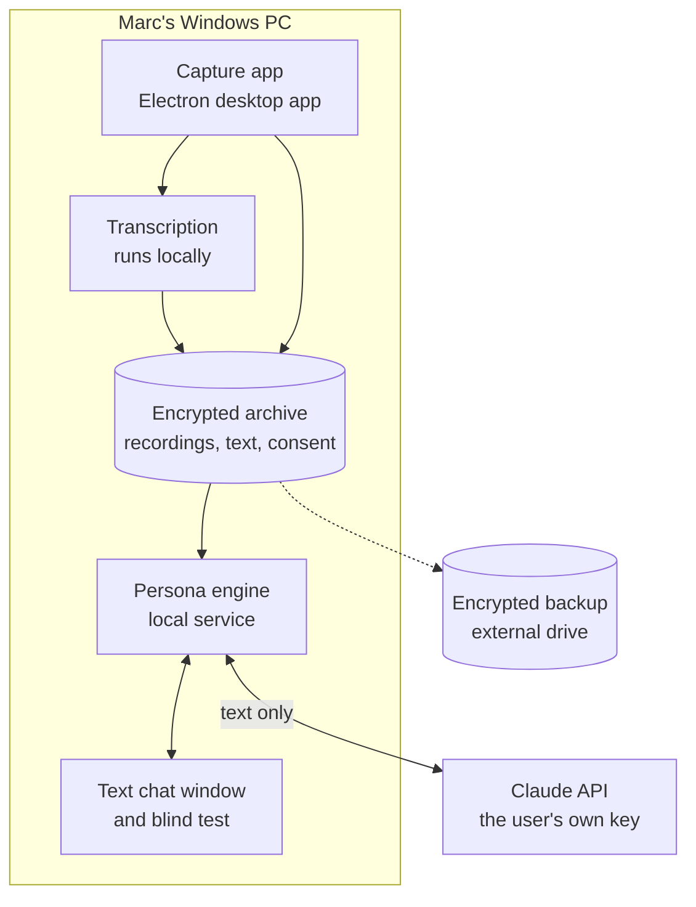
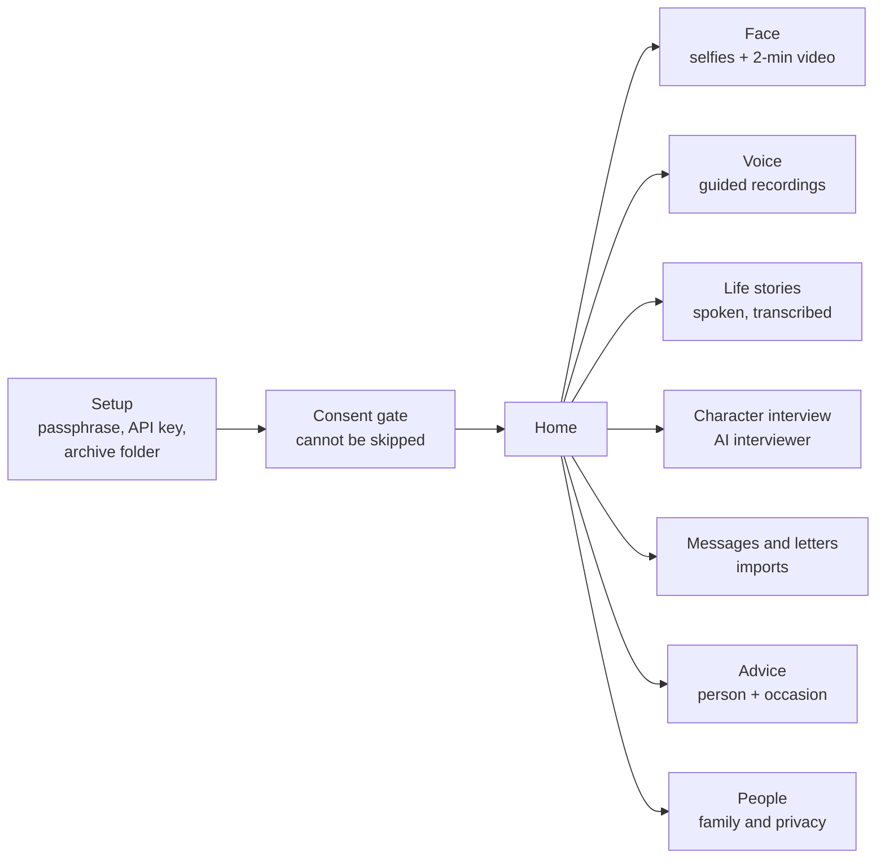
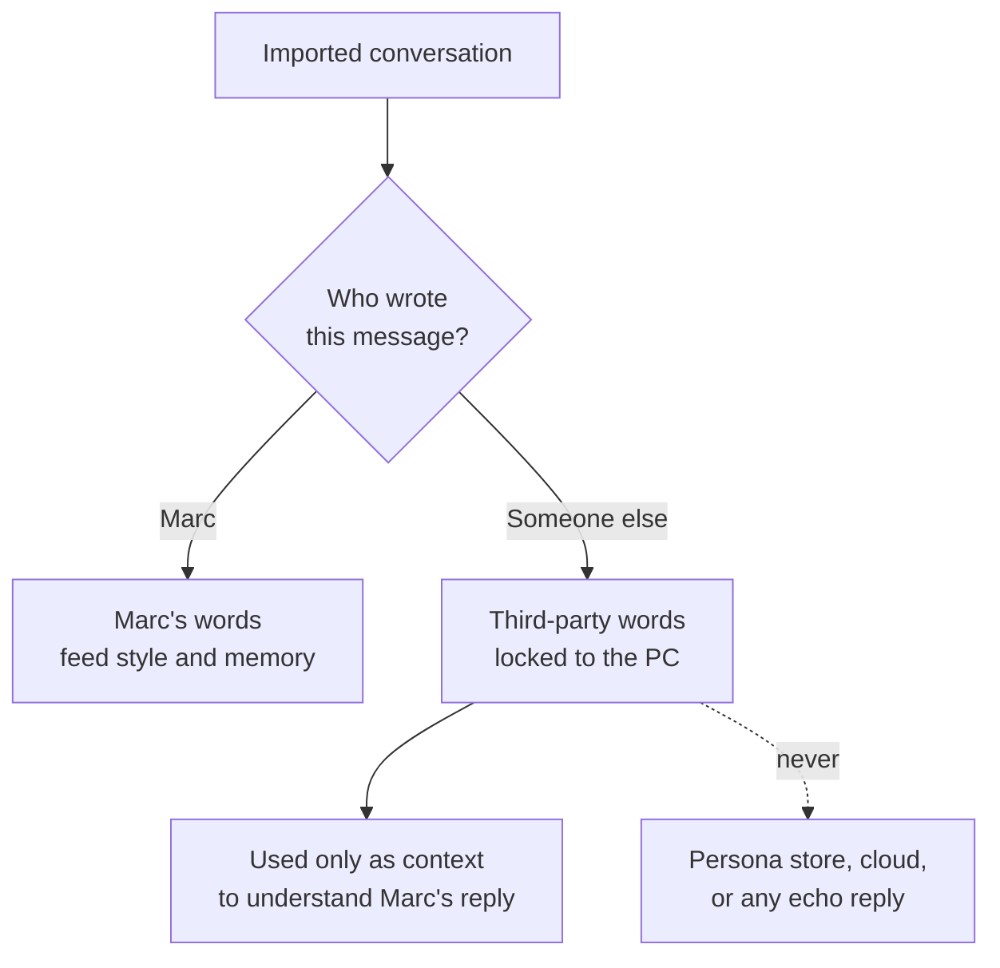
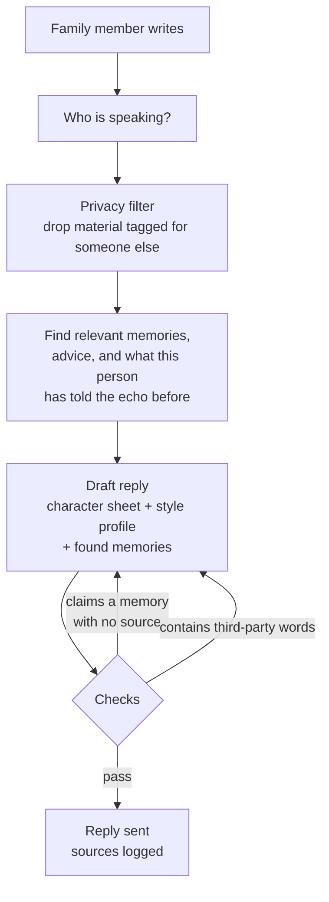

# Echo — design spec for sub-projects 1 and 2

**Status:** All open points answered by Marc on 2026-11-10. Waiting for "merge 1". No code exists.
**Covers:** 1 Capture app, 2 Persona engine, tested through plain text chat.
**Does not cover:** 3 Voice and face, 4 Family access. Each gets its own spec later.

Six points were open (A–F) and a scope change was made in round 4. All are answered; see section 11.

**Reading note:** Echo is built so that anyone can use it to create their own echo (round 4). Marc is the
first user. Wherever this spec says "Marc", read "the person creating their echo".

---

## 1. What gets built

A Windows desktop app a person uses while alive to capture themselves, and an engine that answers in
their voice from that material. Everything in this spec runs on that person's own PC. No cloud
server, no family login, no avatar, no cloned voice.

**Who it is for (round 4):** anyone. Marc offers the tool and is its first user. Each person brings
their own Claude API key and their own storage. Marc hosts nothing, holds nobody's data and pays for
nobody's AI use.

The test of success: Marc and one family member cannot reliably tell the echo's written answers
from Marc's own (section 9).

**What leaves the PC:** text sent to the Claude API, and nothing else. Audio, video and photos never
leave. Other people's words may pass through the API as context while Echo analyses how Marc talks,
but are never stored in the persona store and never quotable (decision A).

---

## 2. Capture app — what Marc sees

A first-run setup and consent gate, then a home screen with one tile per kind of material and a
progress meter on each. Every screen explains in plain English what to do and why, written for
someone who is not technical and has nobody to ask.

| Tile | What it collects | Notes |
|---|---|---|
| Setup | Passphrase, recovery kit, the user's own Claude API key, and where the archive lives | Walks the user through getting a key, step by step, and tests it. A chat subscription cannot be used; Anthropic requires an API key for third-party apps. Recommends a dedicated mailbox for the key so an heir can inherit one login. Storage choice in the first build: a local folder. ICP is added at sub-project 4 |
| Consent gate | A video of the user reading the consent statement (section 3) | Nothing else can be captured until this exists |
| Face | Selfies, plus one continuous guided 2-minute video | Stored as master files for sub-project 3. Not used in 1 or 2 |
| Voice | Guided reading and free talking, target 30+ minutes of clean audio | Master files for sub-project 3. Not used in 1 or 2 |
| Life stories | Marc talks, the app transcribes on the PC, Marc can correct the text | Prompts by life stage; he can also just talk |
| Character interview | An AI interviewer asks, listens, and follows up | Fixed spine of topics; follow-ups are generated. Resumable |
| Messages and letters | Imports, see section 4 | Order: messaging services, then email, then letters |
| Advice | Advice for a named person and a named occasion | Two kinds, both captured: "say when asked" and "release on the day" |
| People | Named family members, how Marc refers to each, relationship | Every item can be tagged "everyone" (default) or one person only |

**Character interview spine:** childhood and family, work, beliefs and values, humour, regrets and
pride, how he handles conflict, money, love and marriage, parenting, what he'd tell each person,
phrases he always says, things he'd never say.

---

## 3. Consent

Recorded on video before anything else, read aloud by the user, with their own name filled in.
Wording approved by Marc (decision C):

> I, [full name], on [date], am creating an AI echo of myself. I consent to my face, my voice and my
> personality being used to create an AI version of me that my named family members can talk to
> after my death. I understand it will always be presented as an AI echo and never as me being
> alive. I can withdraw this consent at any time while I am alive. After my death, my nominated heir
> can pause or delete it.

- Consent is stored in the archive with its date and is written to the audit trail.
- Withdrawing consent locks the persona engine immediately and offers export or delete.
- Avatar and voice vendors each need their own consent step. That belongs to sub-project 3.

---

## 4. Message imports

One importer, one small adapter per service. Adding a service never touches the others.

| Order | Source | How it gets onto the PC | Known limits (checked 2026-11-10) |
|---|---|---|---|
| 1 | WhatsApp | "Export chat" per conversation, a ZIP holding a text file | Exports are capped, reported at about 40,000 messages without media |
| 2 | Messenger | Meta's "Export your information" in JSON, plus the separate download for end-to-end encrypted chats | Two different downloads are needed to get old and new messages |
| 3 | iPhone texts and iMessage | A local iPhone backup on the PC; Echo reads the messages database inside it | Apple has no export button. Needs the backup password if the backup is encrypted. Messages kept in iCloud may be missing from a local backup |
| 4 | Discord | Discord's "Request Data" package, a ZIP of JSON files | Holds only the messages Marc sent, so his side only, with no context. Discord says delivery can take up to 30 days |
| 5 | Email | Decided at the email PR: mailbox export file or a mail connection | |
| 6 | Letters | Photos or scans, read by the app, corrected by Marc | |

Each adapter's format is re-verified against a real export of Marc's when that adapter is built.

**What happens to every imported message**

Third-party words are flagged at import and the flag cannot be removed. They are never copied into
the persona store and never shown in an echo reply.

---

## 5. Persona engine — how a reply is made

Three things are built from the archive, and all three are readable and editable by Marc:

| Built thing | Made from | What it holds |
|---|---|---|
| Memory store | Stories, interview, Marc's own messages, letters, advice | Small passages, each with its source, date, people involved and privacy tag |
| Character sheet | Interview and stories | Values, beliefs, humour, temperament, what he would never say |
| Style profile | Marc's own messages and transcripts | Vocabulary, sentence length, pet phrases, sign-offs, and how he talks to each named person |

**Three kinds of statement the echo can make**

| Kind | Example | Rule |
|---|---|---|
| Memory | "The summer we drove to Cornwall…" | Must trace to a captured passage. No source, no memory |
| View | "Knowing me, I'd tell you to…" | Allowed (decision E). Reasoned from the character sheet and said in Marc's own voice and manner, not as a disclaimer. It is never dressed up as something that happened |
| Nothing | "I never got round to telling Echo about that one." | Said in character. Never filled with an invented memory or fact |

**Natural conversation (Marc's round 2 requirement)**

- Speaks as "I", in Marc's style, to the specific person it is talking to.
- Opens every session with one short line saying it is an AI echo of Marc.
- Asks questions back and follows the thread, instead of answering and stopping.
- Remembers what each family member has told it, kept separately per person. This never alters
  the captured material.
- Brings in "say when asked" advice when the conversation reaches that topic. "Release on the day"
  advice is stored now; how it is delivered is decided in sub-project 4.
- If asked whether it is really Marc, or alive, it says plainly that it is an AI echo.

---

## 6. The rules and where each one is enforced

| Marc's rule | Enforced by |
|---|---|
| Only the person can create their clone, with explicit consent | Consent gate before any capture; consent video in the archive and audit trail. **Known limit:** the app can require the consent video but cannot prove who is in front of the camera. Voice and avatar vendors add their own identity checks at sub-project 3 |
| Presented as an AI echo, never as alive | Session opening line; fixed answer to "are you really him"; cannot be switched off |
| Answers from captured material, says so when it has nothing | Source check on every memory claim; the "nothing" reply; sources logged per reply |
| Private, named family only | In this spec: runs only on Marc's PC behind the passphrase. Family login is sub-project 4 |
| Encrypted at rest, exportable, heir can pause or delete | Section 7. Pause and delete by the heir is sub-project 4; export and delete by Marc is here |
| Never quotes other people's private messages | Third-party flag at import; kept out of the persona store; reply check blocks their text |

---

## 7. Archive, encryption, backup, export

- One archive folder on the PC holding a database plus the master media files. Everything in it is
  encrypted. Nothing is readable without the passphrase.
- **Passphrase** set by Marc at first run and asked for each time the app opens.
- **Recovery kit:** a one-page printout with a recovery code that also opens the archive, to be kept
  with Marc's will for the heir. The app makes Marc prove he has printed it before capture starts.
- **Backup:** the archive lives on one PC, so a dead laptop would lose everything. Echo backs up
  automatically, already encrypted, to an external drive (decision F). Cloud storage is added at sub-project 4.
- **Export:** one button writes everything out in open formats (text, standard audio, video and
  image files, plus a readable index), so the material outlives Echo and any vendor.
- **Delete:** Marc can delete any item, or everything. Deletions are recorded in the audit trail
  without keeping the deleted content.

---

## 8. Audit trail

Yes, everything ends up in an audit trail. It is append-only and stored inside the archive.

Recorded: consent given or withdrawn, every capture and import (what, when, how much), every edit
to the character sheet or style profile, every export, backup and deletion, and for every echo
reply the passages it drew on. No third-party message text is ever written to it.

Pre-launch posture: no users and no live data exist, so there is no migration or cutover work in
this spec.

---

## 9. "Does it sound like me" — the test

1. Marc writes his own answers to 20 questions the echo has never seen. These are kept out of the archive.
2. The echo answers the same 20.
3. Each judge (Marc, and one family member) sees the two answers side by side, unlabelled and in
   random order, picks which is the real Marc, and scores the echo's answer from 1 to 5.
4. The chat window also has a free-chat mode with a "speaking as" selector and a sources panel,
   so Marc can see which captured passages each reply came from.

**Pass bar (decision B):** each judge picks the real Marc no more than 13 times in 20, and the echo
averages 4 out of 5 or better.

---

## 10. Usable by anyone — what that does and does not include

| Built in the first build | Not built |
|---|---|
| Nothing in the app is specific to Marc: names, family and consent come from the user | Selling it, payments, licences |
| Setup screen for the user's own Claude API key | A website, sign-up or accounts |
| The user's own storage: local folder first, ICP at sub-project 4 | Any hosting by Marc; any copy of users' data |
| Plain-English guidance on every capture step | Support desk, auto-update, installer signing (decided in the plan) |
| Claude as the only AI provider, behind one seam so another can be added | Other AI providers |

Every record carries the ID of the person it belongs to.

**Plumbing (Claude's choices):** Electron, TypeScript and SQLite for the app; a local Node service
for the engine, so the same code can move to AWS Lightsail London at sub-project 4; speech-to-text
and search indexing run on the PC; replies come from Claude through the user's own API key, with the
model chosen by measured results in the blind test.

---

## 11. Open points — all answered (2026-11-10)

| | Question | Marc's answer |
|---|---|---|
| **A** | May other people's words go to the Claude API during style analysis? | Yes, in passing only: sent as context, never stored in the persona store, never quotable |
| **B** | Pass bar for the blind test | Agreed: real Marc picked at most 13 times in 20, echo averages 4 out of 5 or better |
| **C** | Consent wording | Approved as drafted in section 3 |
| **D** | Other messaging services | Discord |
| **E** | May the echo give a view on things Marc never spoke about? | Yes, and in Marc's voice |
| **F** | Backup location | External drive now, cloud storage added at sub-project 4 |

**Round 4 — scope (2026-11-10)**

| | Question | Marc's answer |
|---|---|---|
| 1 | Who is the first build for? | Usable by anyone, with Marc as the first user. This replaces "for me and my family only, build nothing for a product" |
| 2 | Which AI sits behind it? | Claude first, by API key, built so other providers can be added |
| 3 | Storage offered in the first build | Local first. ICP added at sub-project 4 |

---

## 12. What happens after approval

1. Marc says "merge 1".
2. Claude writes the implementation plan as PR 2: the list of build PRs in order, each small enough
   to click through. Marc approves it.
3. Build starts, PR by PR.
